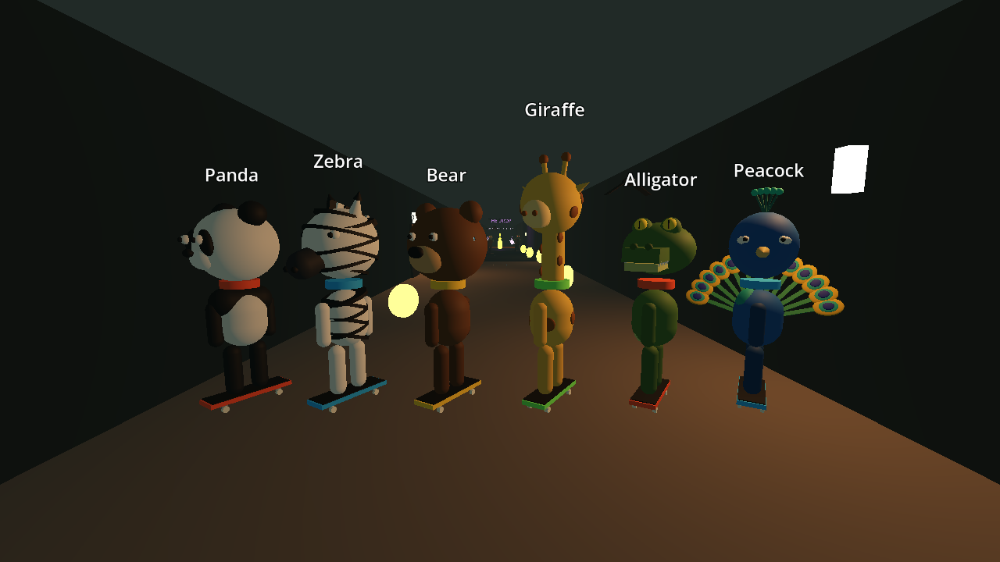

# Tunnel Rush

An online skateboard race for up to 4 players through a flooded tunnel, down two speed tunnels and across a bridge over the bay, built in **Godot 4.7** with its built-in high-level multiplayer (ENet).

Pick your **Big Head** rider: **Panda, Zebra, Bear, Giraffe, Alligator or Peacock** (with a full fan of tail feathers). Race head-to-head with friends or against bots: build speed in three kicks, carry it across the wet floors, then drop into **The Drop**, an 8-second freestyle slope with three kickers. Every trick you land there turns into a speed boost at the bottom. After that, dodge the zombies clawing out of the floor and the bats swooping at your head, smash through crates, and ride the plank over the pit (or ollie it). Grab **tokens** along the way for power boosts.



## How to play

| Action | Keyboard | Gamepad |
|---|---|---|
| Kick (hold) | W / Up | Right trigger |
| Steer | A / D | Left stick |
| Brake | S / Down | Left trigger |
| Ollie | Space | A |
| Flip trick (air) | E | X |
| Grab, hold (air) | F | Y |
| Style trick (air) | R | B |
| Spin, hold (air) | Q | RB |
| Trick variation | W/A/S/D and/or Shift | stick + LB |
| Trick list | Tab (hold) | Back |
| Leave race | Esc | |

### The trick book

25 air tricks plus spins. Add a direction (W/A/S/D) and/or Shift to the trick button for the variation:

| | none | W | A | S | D |
|---|---|---|---|---|---|
| **E** | Kickflip | Varial Kickflip | Heelflip | Impossible | Pop Shove-it |
| **Shift+E** | Double Kickflip | 360 Flip | Inward Heelflip | Hardflip | Laser Flip |
| **F** | Indy | Nosegrab | Melon | Tailgrab | Method |
| **Shift+F** | Stalefish | Rocket Air | Benihana | Madonna | Christ Air |
| **R** | Airwalk | Ollie North | Judo | Body Varial | Superman |

**Spins:** hold Q and let go; the spin finishes on the next half turn: 180, 360, 540, 720, 900 or 1080. An odd number of half turns lands you riding fakie.
**Combos:** every extra trick in the same jump adds 50% to its points. Land mid-trick and you **bail**.

**Kick rhythm:** the 1st kick gets you rolling, the 2nd builds speed, and the 3rd and every kick after hold top speed.
**Floors:** wet floors keep your speed; dry floors drag. Downhills speed you up without kicking.
**The Drop:** the moment you enter the slope an 8-second freestyle timer starts. Your freestyle points become a speed boost (up to +11 km/h) when it ends.
**Tokens:** every 5 gold tokens fire a **Turbo**. Rarer power tokens give a **Turbo** (T, burst of speed), a **Shield** (S, a bubble that shrugs off the next zombie, bat or crash) or **Mega Air** (A, 45% higher ollies for 8 seconds, so bigger tricks on The Drop). Grab the A tokens just before The Drop.
**Momentum:** air drag grows with speed, so top speed comes from the slope, not just kicking; carving hard at speed scrubs a little off. The Drop pulls harder than before.
**Crashes:** hitting a wall head-on costs most of your speed, and at full speed (over ~32 km/h) it throws you off the board (**SLAM!**). A glancing hit just scrapes you along the wall. Land a huge drop flat and you bail. Racers shoulder-bump. Hit a crate fast enough and it smashes.
**Secrets:** some things in this tunnel aren't from this tunnel. Look around.
**After the pit:** drop into **Down Tunnel 1**, a wet downhill tube lit by neon rings, and come out onto **the Bay Bridge**: open air over blue water, a skyline across the bay, and a crowd running for their lives from the zombies chasing them down the sidewalks. Watch for people dashing across the road. Then **Down Tunnel 2**, a cinder-block stairwell tube with handrails, standpipes and wet-floor signs, into the **finish plaza**. Both down tunnels are wet and steep, so they build speed without kicking, and the bridge falls just enough to hold it.
**Zombies** rise out of cracks in the floor, shamble into the lane and sink again on an 8-second cycle. Run into one and you lose speed. **Bats** swoop down to head height and spook you.
**The pit:** take the narrow plank, or ollie the 6 m gap at full speed. Fall in and you respawn at the last checkpoint.

## Multiplayer

- **Race the bots:** you plus 3 bots, offline.
- **Host an online race:** others join your IP on **UDP port 7777**. Add bots to fill the grid, then press **Start race**.
- **Join:** type the host's IP and press Join.

On the same Wi-Fi, use the host's local IP (`ipconfig` on Windows). Over the internet, the host forwards UDP 7777 on their router, or both players use a virtual LAN tool such as Tailscale.

### How it works

- A `MultiplayerSpawner` creates each racer on every peer from the same spawn data (id, grid slot, name, color).
- Each player simulates their own skater; a `MultiplayerSynchronizer` sends position and facing to everyone else. Bots run on the host.
- The host is the referee: it runs the countdown, detects finish-line crossings, and broadcasts results with reliable RPCs, so every screen shows the same times.
- The rider's animation state (kick, lean, spins, board flips, grab and style poses, bails) is synced, so everyone sees everyone's tricks.
- The host decides who grabbed each token and tells everyone, so a token can only be taken once; power effects (turbo flame, shield bubble, Mega Air ring) are synced.
- Zombies and bats move on the shared race clock, so they're in the same place on every screen with no extra network traffic.

## Play it

- **In the browser** (race the bots): the web build. Browsers can't open the UDP connection online races use, so the web version hides Host and Join.
- **Windows download** (everything, including 4-player online): `TunnelRush.exe`.

## Run it

1. Install Godot 4.7.
2. Open this folder in Godot and press **F5**.

### Headless testing

```bash
# Line up all six riders for a screenshot
godot --path . -- --showcase --shots=1.5

# Solo race vs 3 bots as the Zebra, self-driving, prints results
godot --headless --path . -- --solo --animal=Zebra --autopilot --quit-after-race --log-tricks

# Host (expects 3 racers incl. 1 bot) and a client on the same machine
godot --headless --path . -- --host --bots=1 --expect=3 --autopilot --quit-after-race
godot --headless --path . -- --join=127.0.0.1 --autopilot --quit-after-race
```

## Project layout

```
scripts/main.gd    menu, lobby, hosting/joining, spawning, camera
scripts/race.gd    race states, countdown, finish detection, results (host-authoritative)
scripts/skater.gd  skateboard physics, kick rhythm, tricks, freestyle, hazards, bots, sync
scripts/tricks.gd  the trick book: 25 tricks, spins, points
scripts/rider.gd   the six Big Head riders, their animation and power-up effects
scripts/level.gd   the course to the pit, kickers, tokens, zombies and bats, built in code
scripts/city.gd    after the pit: down tunnels, the bridge, water, crowd, plaza, murals
scripts/hud.gd     speed, kicks, clock, position, results
```

## Credits

By Shabang and the Zoo. Every model, including all six riders, zombies, bats, tokens, the crowd and the city, is generated in code, and so is every texture (pavers, cinder blocks, the graffiti murals); no third-party assets.
